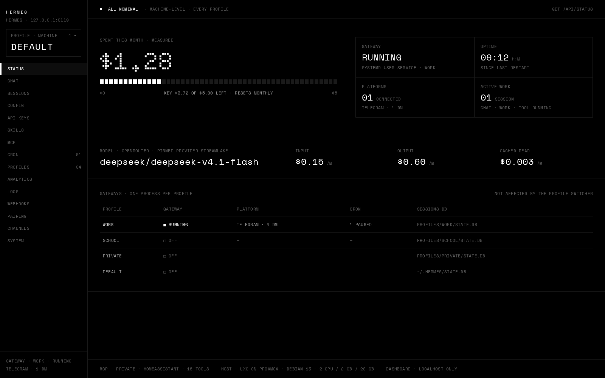
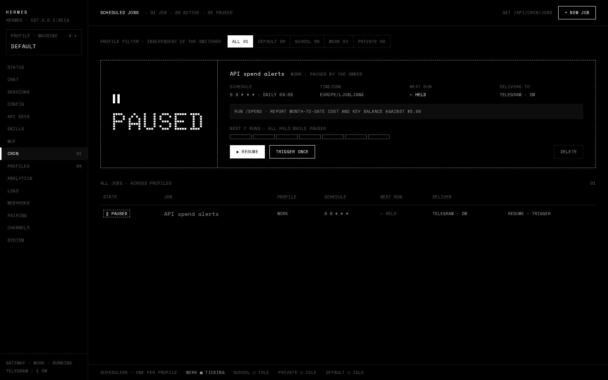
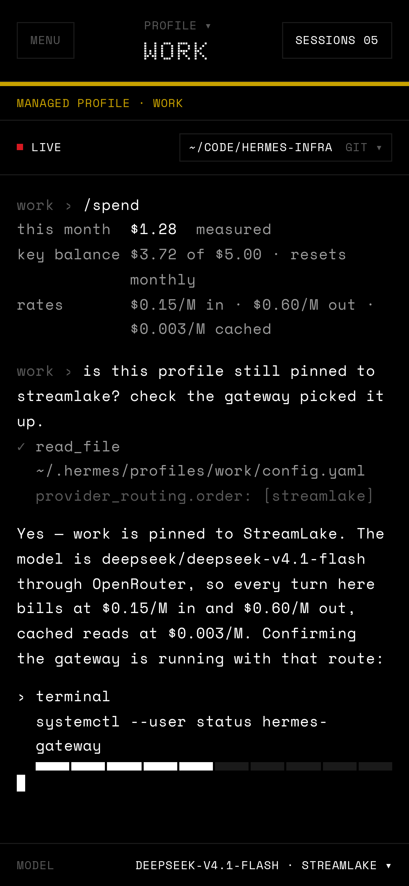

# Nothing style for Hermes

A monochrome, instrument-like look for the [Hermes](https://hermes-agent.nousresearch.com/docs)
agent dashboard — black canvas, hairline rules, one dot-matrix figure per screen, and **red used
only as an interrupt**. Three dashboard themes, two terminal skins, and four dashboard plugins that
carry the same language into the places the theme cannot reach.



*A homage to the [Nothing](https://nothing.tech) design language, built for a real, daily-used
assistant. Not affiliated with Nothing Technology Limited — see the note at the end.*

## What is in the box

| piece | what it does |
|---|---|
| `theme/nothing.yaml` | the flat theme: OLED black, white type, four greys, no depth, no colour |
| `theme/nothing-neu.yaml`, `theme/nothing-neu-light.yaml` | the same language in soft neumorphism, dark and light |
| `skin/nothing.yaml`, `skin/nothing-neu.yaml` | the terminal and the Chat tab, which run Hermes's TUI |
| `plugins/nothing-hud` | the wordmark header, the **Status** tab, and the phone layout |
| `plugins/nothing-lockin` | **Lock In**: file tree, editor, image/PDF/Word/Excel viewers, chat docked beside the files |
| `plugins/nothing-agents` | the **Subagents** tab: a named team per profile, one tool to hand work over |
| `plugins/nothing-settings` | a **Settings** hub that follows the same rules |




## The design rules, in one breath

1. **Colour is an event, not decoration.** No brand colour, no gradient, no shadow-as-depth. The
   grey scale *is* the hierarchy. **Red `#D71921` is the interrupt** — a service down, a budget
   blown, an approval waiting on you — and if nothing is urgent, no red appears at all.
2. **Three type sizes per screen, at most.** A dot-matrix face (Doto) for one hero moment, Space
   Mono for every label, button and table cell, and nothing in between.
3. **Three layers of hierarchy:** the one thing the eye hits first, its context, then metadata that
   never competes.

The full rules — palette table, the type stack with free substitutes, hierarchy, motion, and the
things this language refuses to do — are in **[DESIGN-LANGUAGE.md](DESIGN-LANGUAGE.md)**, and the
values are in **[tokens.css](tokens.css)**.

## Using the design without Hermes

The look is not welded to this dashboard. `tokens.css` is plain CSS custom properties and
`DESIGN-LANGUAGE.md` is a written spec, so a web project of any kind can adopt them:

```html
<link rel="stylesheet" href="tokens.css">
```

The eight `mockups/*.html` pages are self-contained examples — open one in a browser and you are
looking at the design, no server and no Hermes required:

```bash
xdg-open mockups/status.html        # or just drag it into a browser
```

They need internet access for the two Google fonts (Doto and Space Mono). To re-render every mockup
to PNG, at desktop and phone sizes:

```bash
npm install playwright && npx playwright install chromium
node tools/shot.mjs                 # writes screenshots/<name>--desktop.png and --phone.png
```

That is the honest test of the design: change `tokens.css`, re-render, look. Every screenshot in
this README was produced that way, from these files.

## Installing it on a Hermes dashboard

```bash
cp theme/*.yaml ~/.hermes/dashboard-themes/
cp skin/*.yaml  ~/.hermes/skins/
for p in nothing-hud nothing-lockin nothing-agents nothing-settings; do
    cp -r plugins/$p ~/.hermes/plugins/$p && hermes plugins enable $p
done
hermes config set dashboard.theme nothing
hermes config set display.skin nothing
# then restart the dashboard — a new plugin's route is mounted at startup only
```

**[INSTALL.md](INSTALL.md)** has the full steps, how to verify that it actually took, how to
uninstall, and an honest list of what the theme does not reach. **[PROMPT.md](PROMPT.md)** is the
same install written as a prompt you can hand to an agent.

Requirements: a Hermes install with the dashboard (checked against 0.19 and 0.21.5). Nothing in
Hermes's own source is patched — every file is drop-in, which is what makes uninstalling one
command.

## A note on the name

This is an **homage**, not a clone, and it is not affiliated with Nothing Technology Limited. The
Nothing wordmark, logo and the NDot/NType/Lettera typefaces are their property and **none of them
are included here**: the type is free look-alikes (Doto, Space Mono, Space Grotesk) and the wordmark
is plain text you can change to anything.

## Licence

MIT — see [LICENSE](LICENSE). Use it, fork it, restyle it.
